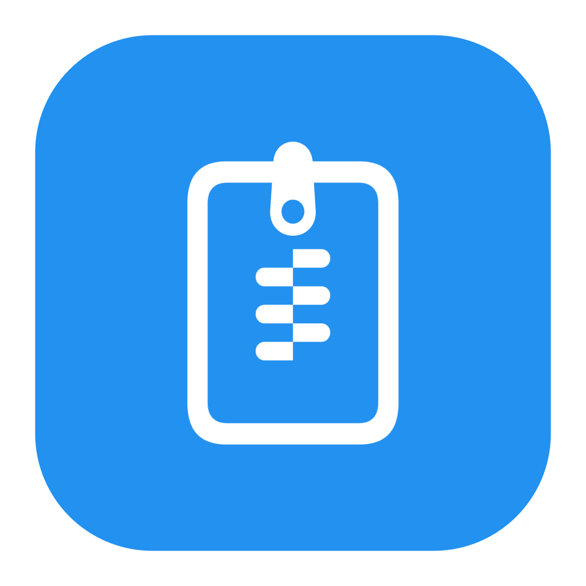
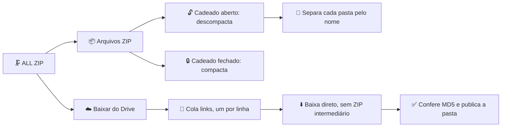

# 🗜️ ALL ZIP

<div align="center">




### Compacte, descompacte e baixe pastas do Google Drive no macOS, sem ZIP intermediário

[](https://github.com/WennyLife/ALL-ZIP)
[](https://github.com/WennyLife/ALL-ZIP)
[](https://github.com/WennyLife/ALL-ZIP)
[](https://github.com/WennyLife/ALL-ZIP)

**Arraste seus ZIPs e o ALL ZIP descompacta ou compacta na hora. Cole links do Google Drive e ele baixa arquivos e pastas inteiras, com progresso real, pausa e retomada!**

[Download macOS (.dmg)](https://github.com/WennyLife/ALL-ZIP/raw/main/release/ALL-ZIP-1.1.6.dmg) • [Download (.zip)](https://github.com/WennyLife/ALL-ZIP/raw/main/release/ALL-ZIP-1.1.6.zip)

</div>

---

## 💡 O que é o ALL ZIP?

O **ALL ZIP** é um app nativo para macOS com duas funções:

* **Arquivos ZIP:** arraste arquivos para a janela. Com o cadeado aberto ele **descompacta**; com o cadeado fechado ele **compacta** em ZIP rápido.
* **Baixar do Drive:** cole links de arquivos ou pastas do Google Drive (um por linha) e o app baixa direto para a pasta escolhida, sem criar ZIP intermediário.

## ✨ Principais funcionalidades

* 📂 **Separação automática de pastas (1.1.6):** ao arrastar muitos ZIPs de pastas diferentes (por exemplo, downloads divididos do Drive), o app limpa sufixos técnicos (`-001`, `_part1` etc.), agrupa pelo nome da pasta e extrai cada uma em separado.
* ⚡ **Compactação rápida:** DEFLATE nível 1, priorizando velocidade.
* 📊 **Progresso real:** barras com porcentagem, bytes e velocidade. Enquanto o total não é conhecido, mostra "Preparando", sem inventar porcentagem.
* ⏯️ **Pausar e retomar** enquanto o app está aberto. Em falhas temporárias tenta até 3 vezes, retomando do arquivo parcial (HTTP Range).
* ✅ **Conferência MD5** do conteúdo baixado quando o Drive fornece o hash.
* 📄 **Docs, Sheets, Slides e Drawings** do Google são exportados em DOCX, XLSX, PPTX e PNG.
* 🛡️ **Segurança:** nada é substituído automaticamente, originais ficam preservados, e links, caminhos perigosos e tipos especiais são bloqueados.

## 📐 Como o ALL ZIP funciona



---

## 📥 Instalação

1. Baixe **[`ALL-ZIP-1.1.6.dmg`](https://github.com/WennyLife/ALL-ZIP/raw/main/release/ALL-ZIP-1.1.6.dmg)**.
2. Abra o `.dmg` e arraste o **ALL ZIP** para **Aplicativos**.
3. Na primeira vez, o macOS pode pedir confirmação por o app ter assinatura *ad hoc* (não notarizada): clique com o botão direito no app e escolha **Abrir**.

**Requisito:** macOS 26.0 ou mais novo.

## 🔑 Conta Google

O download do Drive usa a conta Google que você conectar no app (permissão somente leitura, `drive.readonly`). O login do Google está em modo **teste**: só contas cadastradas como usuário de teste do projeto conseguem conectar.

## 🛠️ Compilação a partir do código-fonte

Requer as Command Line Tools da Apple (`clang`, `swiftc`) e a `libarchive`.

```bash
git clone https://github.com/WennyLife/ALL-ZIP.git
cd ALL-ZIP/src
python3 build.py
```

O `build.py` gera o `ALL ZIP.app` em uma pasta temporária (o caminho aparece em `build-location.txt`).

> [!NOTE]
> O `GoogleOAuthClient.json` (credencial do login Google) **não está** no código-fonte. Para o download do Drive funcionar no seu build, crie uma credencial *OAuth Desktop* no Google Cloud, copie `src/GoogleOAuthClient.json.exemplo` para `src/GoogleOAuthClient.json` e preencha com os seus dados antes de rodar o `build.py`. Os instaladores da pasta `release/` já vêm prontos para usar.

## ✅ Testes

Há testes de motor ZIP, compactação, extração múltipla, rede/Drive, agrupamento e publicação em `src/test_*`.

---

## 💻 Requisitos de Sistema

* **macOS:** 26.0 (Tahoe) ou superior.
* **Processador:** Apple Silicon (M1, M2, M3, M4). Os binários atuais são `arm64`; não há versão Intel.
* **Internet e conta Google:** só para a aba **Baixar do Drive**. Compactar e descompactar ZIP funciona offline.
* **Permissões:** nenhuma permissão especial de acessibilidade ou extensão de kernel.

---

## 📄 Licença

Este projeto é distribuído sob os termos da licença **MIT**. Consulte o arquivo [LICENSE](LICENSE) para mais detalhes.

---

<div align="center">
Desenvolvido com carinho por <a href="https://github.com/WennyLife"><strong>WennyLife</strong></a>
</div>
